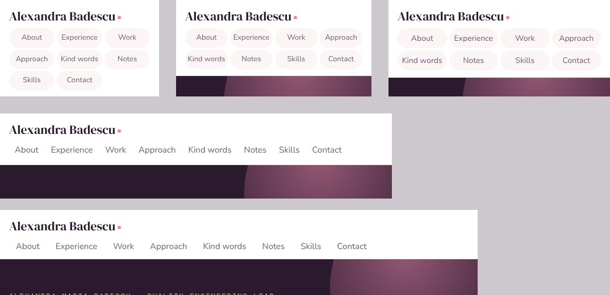

# I gave AI a website to build. Then I gave myself a much bigger testing problem.

I wanted a personal website, but I wasn't keen on spending my evenings becoming a frontend developer. So I gave an AI assistant the building job. It wrote the code, helped shape the content and ran the checks. I supplied the facts, reviewed the drafts, challenged what didn't look right and kept the final say on what went live.

Being a QA engineer, I couldn't just accept a green report and move on. I wanted to know whether the checks were any good, especially since the same assistant that built the site was also running them.

It turned out one of the checks could report success without testing anything at all. Not exactly the reassurance I was looking for.

So I tested the checks themselves, with deliberately broken examples and valid examples that must still pass. This is what I found, what I changed and how I decided what was safe to publish on [alexandrabadescu.com](https://alexandrabadescu.com).

**Skills this shows:** risk-based test design · testing the tests (negative tests and positive controls) · requirements traceability · Playwright and axe-core (WCAG 2.2 AA) · responsive and dark-mode layout checks · GitHub Actions CI · BDD specifications (Gherkin) · impact-based bug triage · release go/no-go decisions · evaluating AI-written content



*The menu at five of the eight screen widths every check runs at (bug [D02](docs/defects.md#d02-menu-labels-cut-off-on-folding-phone-cover-screens)).*

## The short version

| What I looked at | Result |
|---|---|
| The website | 64/64 checks passed on the deployed files (4 pages × 8 screen widths × light and dark mode), 30 October 2026 |
| Links | 49 internal links and anchors checked, 0 broken |
| The checks themselves | 38/38 behaved as required: 31 deliberately broken inputs were caught, and 7 valid inputs passed |
| Bugs | 15 investigated: 8 in the website, 5 in the checks, 2 that weren't bugs. All fixed, 0 open |
| AI-written content | One test run, every line traced back to its source: 0 invented claims |
| CI | Every push runs all the tests on Node 22 and 24; the release check has its own dry run |
| Release 2 (1 Nov 2026) | A Projects section, a phone menu and shorter About: 64/64 checks, 66 links, menu tested at 10 widths and on a real iPhone, then deployed after my go ([record](docs/release-evidence.md#release-2-1-november-2026)) |

What this does and doesn't prove is in [Limits](#limits), in one place.

## Pick your route

- **Hiring manager / product:** [the decisions](docs/decisions.md) then [the bug log](docs/defects.md) then [the report](docs/test-report.md). Five minutes, no terminal required.
- **QA:** [user stories](docs/user-stories.md) then [quality gate requirements](docs/quality-gate-requirements.md) then [traceability](docs/traceability.md) then [tests](tests/run-tests.js).
- **Engineer:** [run it](#run-it-yourself) then [checks](checks/) then [CI](.github/workflows/checks.yml) then [release workflow](.github/workflows/release-artifact.yml).
- **AI quality:** [fabrication review](docs/fabrication-review.md) then [evaluation plan and cases](evals/README.md).

## My approach

1. **Start with what could go wrong.** Inaccurate claims about my work, an exposed contact detail, inaccessible navigation, a broken CV, and a green pipeline that checked the wrong thing were not acceptable outcomes.
2. **Turn the risks into something checkable.** Requirements link to tests; each negative fixture contains one known defect; valid controls guard against false alarms.
3. **Make failures explain themselves.** For negative tests, a failure exit code isn't enough. The check must report the right kind of failure, and where it matters, on the right page, screen width or colour mode.
4. **Leave human judgement where it belongs.** A script can't decide whether a story is true, whether a sentence sounds like me, or whether a screen reader experience is actually usable.
5. **Make an explicit release call.** The assistant can recommend; I say go or no-go. If evidence is missing, I record it rather than polish it away.

## Three bugs that changed how I worked

**T01: Everything passed. Nothing ran.** A mistyped site path gave the quality gate nothing to inspect, and it still reported green. I changed the gate to fail when no pages are found, and added negative tests for invalid or empty inputs. Lesson: a pipeline can be green and completely useless.

**D08: Dark mode made the headline unreadable.** A colour chosen for light mode didn't have enough contrast on a dark background. The fix was a dark-theme accent, plus a regression test that fails **only** in dark mode. Lesson: test the other paths, not just the happy one.

**T05: A reference number became a phone number.** My public-CV privacy check flagged a long reference number as a phone number. A positive control caught it before an overzealous rule could block a release. Lesson: tests that only catch defects are half the job; they also need to leave correct things alone.

Full evidence, fixes and impact reasoning: [the bug log](docs/defects.md). How I prioritised them: [the impact model](docs/bug-template.md).

## What's automated

- `checks/site-checks.js` crawls every linked page, then checks links and anchors, sideways scrolling (before and after expanding collapsible sections), WCAG 2.2 AA rules with axe-core, and console errors, at **8 widths × 2 colour modes**. The JSON report includes each accessibility failure's rule, impact, help link and affected elements.
- `checks/cv-checks.py` checks the PDF's page count, that its text can be extracted, how full each page is, and that a public CV contains no email or phone number.
- `checks/validate-specs.js` checks that the 59 Gherkin scenarios are valid. They're specifications, not executed BDD tests.
- `tests/run-tests.js` runs 31 known-defect fixtures and 7 valid controls, demands exactly the expected failure types, and checks that every requirement has a test and every test has a requirement.
- `.github/workflows/checks.yml` runs all of the above on every push and pull request, on Node 22 and 24, and first checks that no commit exposes a personal email address.
- `.github/workflows/release-artifact.yml` checks the exact files of a release: it verifies a ZIP's full SHA-256, unpacks it safely and runs the site and CV checks on it. It runs as a dry run on the fictional sample site whenever it or the checks change, including a test that a wrong hash is rejected.

## Run it yourself

Needs Node.js 22 or later and Python 3.12 or later.

```bash
npm ci
npx playwright install chromium
pip install -r requirements.txt   # also install poppler-utils (apt or brew)
npm run build:fixtures            # build the fictional PDF test cases
node examples/src/make-cvs.js     # build the fictional sample CVs
npm test                          # the 38 requirement-based tests
npm run test:report               # results, plus a regenerated traceability matrix
```

To check your own static site and CV:

```bash
node checks/site-checks.js path/to/site --report report.json
python3 -B checks/cv-checks.py path/to/public-CV.pdf
python3 -B checks/cv-checks.py path/to/application-CV.pdf --allow-contact
```

A negative test passes only when the check catches exactly the defect that was put in. A positive control must pass with no failures. The [traceability matrix](docs/traceability.md) records the last results.

## Limits

- **Accessibility:** automated rules cover only part of WCAG 2.2 AA. Keyboard, focus, zoom, text spacing and screen-reader checks are manual, and weren't repeated for the 30 October report.
- **Release link:** the real-site run used the deployed files, not a crawl of the live URL. The release workflow is tested with a dry run, but isn't connected to the website's build and deploy yet ([release evidence](docs/release-evidence.md)).
- **AI claims:** "never invent facts" in a prompt is an instruction, not proof. The [fabrication review](docs/fabrication-review.md) is one run with a fictional CV, which I reviewed and signed off on 1 November 2026. Harder [evaluation cases](evals/README.md) are written but not yet run.
- **Browsers:** Chromium is automated. Safari and Firefox were checked by hand.
- **CV checks:** extractable text is needed for ATS parsing but doesn't guarantee it, and the contact and page-fill checks are heuristics.
- **Estimates:** the share of dark-mode visitors and other user bands are assumptions for prioritising, not analytics. The site collects none, by design.

## What I'd improve next

The checks are proven against known defects. The next step is proving that the **exact build going to production** is the one that was tested: the website's build hands its ZIP to the release workflow, and the hash, report and my go/no-go decision are recorded together. See the [release evidence checklist](docs/release-evidence.md) and the [technical follow-ups](docs/technical-follow-ups.md).

## Licence

© 2026 Alexandra Badescu. Licensed under [CC BY-NC-ND 4.0](LICENSE): you're welcome to read it, use the checks for your own non-commercial website or job search, and share it unchanged with credit.

[Website](https://alexandrabadescu.com) · [LinkedIn](https://www.linkedin.com/in/alexandra-maria-badescu/)
